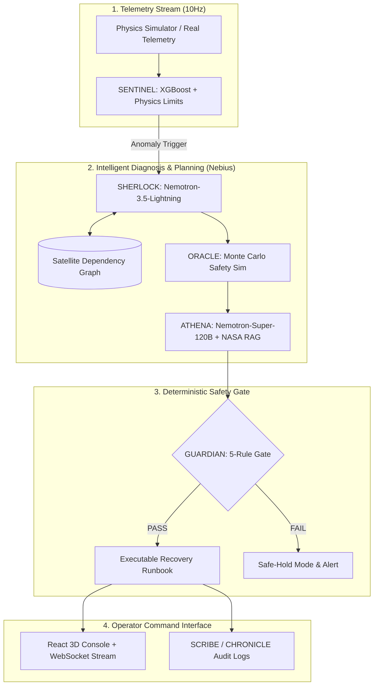

# 🛰️ Aero-Astra: Autonomous Satellite Fault Management
### Hackathon Presentation Deck Content (Nebius × NVIDIA Track: Best Apps & Agents)

---

## Slide 1: Title Slide
- **Project Name:** Aero-Astra
- **Subtitle:** Autonomous LEO Satellite Fault Detection, Isolation, and Recovery (FDIR)
- **Engine:** Powered by NVIDIA Nemotron on Nebius Token Factory & Nebius AI Cloud
- **Team / Track:** Best Apps and Agents — Nebius × NVIDIA Global AI Hackathon

---

## Slide 2: Explain Your Problem Statement
- **LEO Constellation Explosion:** 10,000+ satellites orbiting Earth today; projected 50,000+ by 2030.
- **The Ground Pass Bottleneck:** LEO passes last only **8–12 minutes**; ground stations cannot staff human operators 24/7 for every satellite pass.
- **The Anomaly Window Dilemma:** A thermal runaway or reaction wheel saturation can turn a $50M spacecraft into orbital debris in minutes—long before the next contact window.
- **The AI Dilemma:** Traditional automation is brittle; generic LLMs hallucinate telemetry values and unverified recovery steps, making them dangerous for aerospace deployment.

---

## Slide 3: Explain Need and Background
- **Hostile Orbital Environment:** Radiation upsets (SEUs), thermal extremes (-150°C to +120°C), and micro-meteoroid impacts trigger frequent sub-system degradation.
- **Mission Criticality:** Earth observation, global defense telecom, weather warning systems, and navigation depend on 99.999% satellite uptime.
- **Why Now:** 
  - Mega-constellations outpace human flight controller capacity by **100:1**.
  - Need an **autonomous, verifiable, hallucination-free co-pilot** operating in real-time.

---

## Slide 4: Existing Solutions and Their Limitations

| Existing Approach | How It Works | Critical Limitations |
|---|---|---|
| **Static Threshold FDIR** | Hardcoded `if telemetry > limit` rules | Fails on cross-subsystem cascading faults; triggers false-positive alarm storms. |
| **Ground-in-the-Loop** | Downlink telemetry → Human triage → Uplink plan | **4–12 hour latency**; ground passes are too short to troubleshoot complex failures. |
| **Unconstrained LLMs** | Raw LLM prompt fed with telemetry | **Hallucinates fake parameters**, invents non-standard commands, non-deterministic safety risk. |

---

## Slide 5: Solution Description
**Aero-Astra** is an end-to-end autonomous multi-agent FDIR pipeline that replaces panic with deterministic safety:
- **Detects** telemetry anomalies in real-time via physics-informed ML.
- **Diagnoses** root causes strictly bound to a satellite dependency graph using **NVIDIA Nemotron** on **Nebius Token Factory**.
- **Simulates** recovery risk via deterministic Monte Carlo state-space simulations.
- **Synthesizes** auditable, schema-compliant recovery plans validated against NASA FDIR handbook rules.
- **Gates** every action through **GUARDIAN**—a zero-LLM deterministic safety firewall.

---

## Slide 6: Features & Unique Selling Proposition (USP)

### Key Features
- **7-Agent Autonomous Pipeline:** SENTINEL, SHERLOCK, ORACLE, ATHENA, GUARDIAN, SCRIBE, CHRONICLE.
- **Real-Time 3D Digital Twin:** 60 FPS Three.js orbit visualization with synchronized telemetry and attitude tracking.
- **Pre-Flight Runbook Generation:** Generates operator-ready recovery plans with execution timers, rollbacks, and risk levels.

### Core USPs (Why We Are Different)
1. **Zero-Hallucination Guarantee:** Root causes must belong to a verified dependency graph candidate set.
2. **Deterministic Safety (No AI Guesswork):** Safety scores are computed via 500-run Monte Carlo simulations, **never** output by an LLM.
3. **Hard Fail-Safe Gate:** GUARDIAN rejects unverified, high-risk, or non-idempotent commands before uplink.
4. **Dual Nemotron Architecture:** Fast 8B diagnosis paired with deep 120B structured planning on Nebius Token Factory.

---

## Slide 7: How Solution Addresses the Problem
- **Response Time: Minutes vs Hours:** Reduces anomaly identification and recovery formulation from **4+ hours to <45 seconds**.
- **Eliminates Operator Burnout:** Filters telemetry alarm fatigue; presents ground controllers with verified, scored options.
- **Safeguards Flight Safety:** Prevents satellite loss during radio silence (out-of-contact orbital passes).
- **Audit-Ready Aerospace Compliance:** Every agent thought, probability score, and gate check is immutably logged into structured runbooks.

---

## Slide 8: Tech Stack

- **AI & LLM Inference:**
  - **Nebius Token Factory:** Ultra-low latency OpenAI-compatible inference API.
  - **SHERLOCK (Diagnosis):** `nvidia/Nemotron-3_5-Lightning`
  - **ATHENA (Recovery Planning):** `nvidia/nemotron-3-super-120b-a12b`
- **Machine Learning & RAG:**
  - **XGBoost:** Anomaly classification trained on real ESA OPS-SAT telemetry.
  - **ChromaDB + Sentence-Transformers:** Offline-first RAG embedding NASA-HDBK-1002 FDIR handbook.
- **Backend & Simulation:**
  - **FastAPI (Python 3.11):** Async WebSocket telemetry streaming at 10Hz.
  - **NumPy & SciPy:** Deterministic Monte Carlo safety engine (ORACLE).
  - **NetworkX:** Subsystem dependency graph (ADCS, EPS, TCS, COMMS, PAYLOAD, PROP).
- **Frontend & Visualization:**
  - **React 18 + Vite:** High-performance operator console.
  - **Three.js / React Three Fiber:** Real-time 3D satellite attitude & orbital mesh.
- **Cloud & Deployment:**
  - **Nebius AI Cloud:** CPU-optimized hosted VM, Docker Compose, Nginx reverse proxy.

---

## Slide 9: System Architecture

---

## Slide 10: Methodology & Implementation Process

### Phase 1: Real-Time Stream Ingestion & Detection
- Ingests multi-channel telemetry (Battery Temp, Bus Voltage, Gyro Rates, Star Tracker SNR).
- Multi-tier detection: Static bounds + residual correlation + flatline detection.

### Phase 2: Graph-Constrained Root-Cause Isolation
- SENTINEL flags degraded telemetry → SHERLOCK maps symptoms to component graph.
- Calls `Nemotron-3.5-Lightning` with candidate bounds; invalid nodes are rejected by code.

### Phase 3: Monte Carlo Risk Simulation
- ORACLE simulates 500 perturbed scenarios (temperature, battery depth of discharge, attitude error).
- Yields a statistical confidence interval (e.g., `Survival Probability: 94.2%`).

### Phase 4: Structured Plan Generation & GUARDIAN Gate
- ATHENA generates strict JSON action sequences (Safe-mode, Heater power cycle, Reaction wheel desaturation).
- GUARDIAN enforces 5 zero-tolerance flight rules (power budget, attitude stability, thermal ceilings, non-idempotency, reversibility).

---

## Slide 11: Social, Environmental & Governmental Impact

### 🌍 Environmental Impact (Space Sustainability)
- **Active Debris Prevention:** Prevents dead satellites from becoming uncontrolled debris projectiles in congested LEO orbits (Kessler Syndrome mitigation).
- **Mission Life Extension:** Timely recovery from partial failures extends operational satellite lifetime by 2–4 years, reducing new hardware launch footprints.

### 🏛️ Governmental & Defense Resilience
- **Sovereign Constellation Autonomy:** Protects national earth observation and communication satellites against unexpected radiation storms and space weather.
- **Air-Gapped Operational Capability:** Can run fully on localized sovereign AI infrastructure (Nebius AI Cloud) without reliance on public consumer LLM APIs.

### 👥 Social Impact
- **Protects Vital Ground Infrastructure:** Keeps weather monitoring, GPS tracking, and rural satellite internet uninterrupted.

---

## Slide 12: Challenges and Mitigations

| Challenge | Risk | Mitigation in Aero-Astra |
|---|---|---|
| **LLM Hallucinations** | Wrong recovery command burns propulsion or drains battery | **Graph-bounded classification + Pydantic validation**; LLM output choices are restricted to pre-validated sets. |
| **Safety Certification** | Space agencies reject black-box AI outputs | **Zero-LLM GUARDIAN gate + ORACLE Monte Carlo**; all safety criteria are mathematically verified in code. |
| **Compute Constraints** | Heavy models cannot run onboard small satellites | **Nebius Token Factory API**: Offloads heavy inference; edge-side agent uses lightweight quantized models. |
| **Communication Gaps** | Satellite out of ground station contact | **Autonomous Closed-Loop Mode**: System safely holds spacecraft until next pass without human intervention. |

---

## Slide 13: Economic Viability, Commercialisation & Scalability

### Market Opportunity
- **NewSpace Boom:** 2,500+ smallsats launched annually; ground operations represent **up to 25% of lifetime mission OPEX**.
- **Addressable Market:** $15B+ Constellation Management and Satellite Operations market by 2030.

### Business & Commercial Model
- **Tier 1: Constellation SaaS:** Subscription fee ($500–$2,000/satellite/month) for commercial LEO operators.
- **Tier 2: Enterprise Ground Station Integration:** Integration license for ground networks (AWS Ground Station, KSAT, Leaf Space).
- **Tier 3: Defense & Sovereign Cloud:** On-prem / isolated deployment on Nebius private compute clusters.

### Scalability Strategy
- **Horizontal Microservices:** Stateless FastAPI backends running on Nebius AI Cloud handle 1,000+ simultaneous spacecraft telemetry streams.
- **Token Efficiency:** Leverages fast Nemotron-3.5-Lightning for continuous triage; triggers larger 120B planning model only on confirmed anomalies.

---

## Slide 14: Conclusion & Hackathon Submission Highlights
- **Delivered:** Fully functioning multi-agent FDIR system running on **Nebius Token Factory** and **NVIDIA Nemotron**.
- **Proven:** Physics-backed telemetry, zero-hallucination graph verification, and real-time 3D operator dashboard.
- **Vision:** Enabling autonomous, self-healing satellite mega-constellations for the next era of human space exploration.
- **Try it:** Live demo & GitHub repo available!
